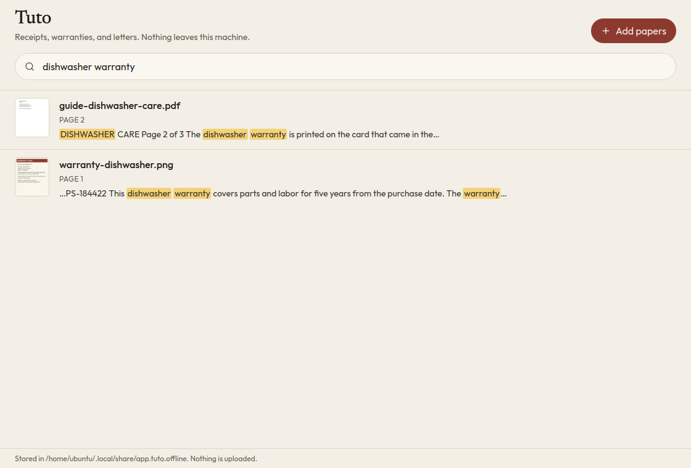

# Tuto

From the Latin *in tuto*, in safety. Your home is the castle: drop in receipts, warranties, and letters, then search “dishwasher warranty.” Airplane mode on, it still works, and nothing is uploaded.



## Why offline

Tuto is a private finder for paper you already have, a Fort Knox that never leaves the house. There is no account, no sync, and no telemetry. Photos and PDFs are copied into the app data folder, read on this machine, and indexed in a local SQLite database. Turning the network off changes nothing, because the app never asks the network for anything.

## Install

Tuto reads English with [Tesseract](https://github.com/tesseract-ocr/tesseract) and reads PDFs with Poppler. Install both before the first launch.

**Mac.** Build a `.dmg` on a Mac with the steps below (`pnpm tauri build --bundles dmg`). The app is unsigned. The first time you open it, right-click Tuto and choose Open.

**Linux.** Build the `.deb` with the command below, then install it with `sudo apt install ./src-tauri/target/release/bundle/deb/Tuto_0.1.0_amd64.deb`. An AppImage is `pnpm tauri build --bundles appimage`. You also need the OCR tools:

```bash
sudo apt install tesseract-ocr tesseract-ocr-eng poppler-utils
```

On Arch, including Omarchy:

```bash
sudo pacman -S --needed tesseract tesseract-data-eng poppler fuse2
```

On Hyprland, start the AppImage with `WEBKIT_DISABLE_DMABUF_RENDERER=1`. WebKitGTK 4.1 is already inside the AppImage.

**Windows.** Not shipped. Build from source on Windows and put `tesseract` and `pdftotext` on `PATH`.

## How it works

1. A dropped file is copied into the app data directory (`~/.local/share/app.tuto.offline` on Linux). The footer of the window shows the exact folder.
2. Photos are read with Tesseract. A PDF that already has a text layer keeps that text. A scanned PDF is rendered with Poppler and then read with Tesseract.
3. The words go into a SQLite FTS5 index in `tuto.db`, next to the copies. Search returns a snippet with the matches highlighted.

The same Tesseract path is used on every platform so the app can be tested without Apple's Vision framework. A Mac build can later swap in a Vision sidecar behind that one function.

## Supported files and limits

- Photos: PNG, JPEG, WebP, TIFF, GIF
- PDFs, including multi-page files
- English text only
- The first 30 pages of a PDF
- Files up to 40 MB
- A crooked photo still runs through OCR, and a bad phone picture can come back garbled. A straight copy of the same page reads more reliably.

Tuto does not sync, sign in, capture from a camera, summarize with a cloud model, or encrypt the library at rest.

## Try the sample papers

`fixtures/samples` holds 20 fake documents: receipts (one totals 42.99), a dishwasher warranty card, a utility bill, a letter from Mara Ellison, a three-page care guide, a scanned PDF, and a rotated phone photo. No real identities or papers. When you run from this repository, the empty library offers **Try sample papers**. Regenerate them with:

```bash
python3 fixtures/generate.py
```

That script needs Pillow and the DejaVu fonts.

## Build from source

Install Rust (1.90 or newer), Node.js, and pnpm. On Linux, also install the Tauri system packages from the [v2 prerequisites](https://v2.tauri.app/start/prerequisites/), plus Tesseract and Poppler.

```bash
pnpm install
pnpm tauri dev
```

The dev server listens on port 43123. The window is the app. Search and import run there, not in a plain browser tab.

```bash
pnpm tauri build --bundles deb    # Linux
pnpm tauri build --bundles dmg    # Mac
```

## Hackyard Yard #6

Built for Hackyard Yard #6, a private document finder that keeps working in airplane mode. MIT licensed. See [LICENSE](LICENSE), the demo beats in [DEMO.md](DEMO.md), and the short judging note in [WRITEUP.md](WRITEUP.md).
